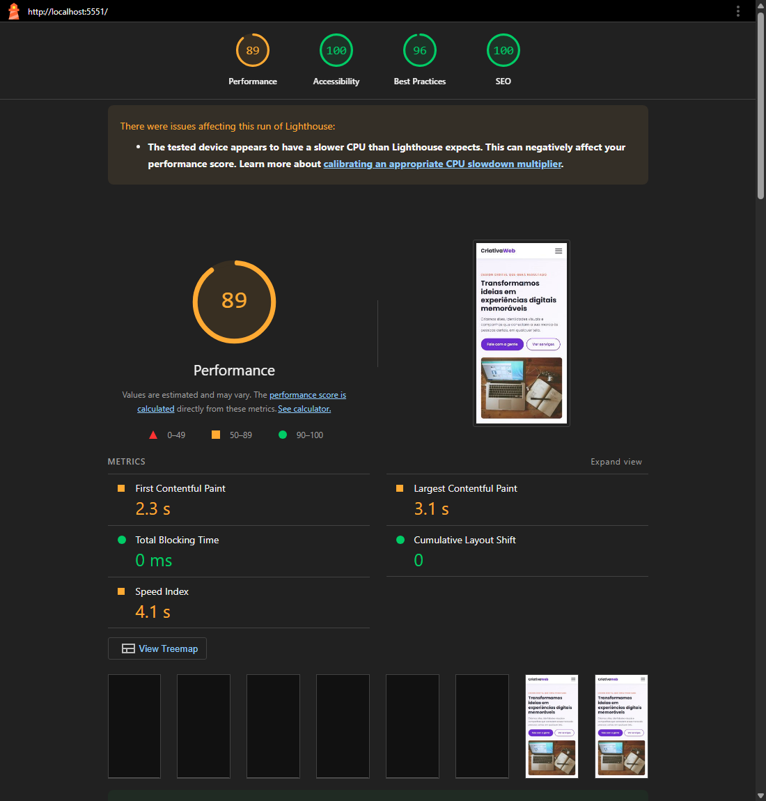
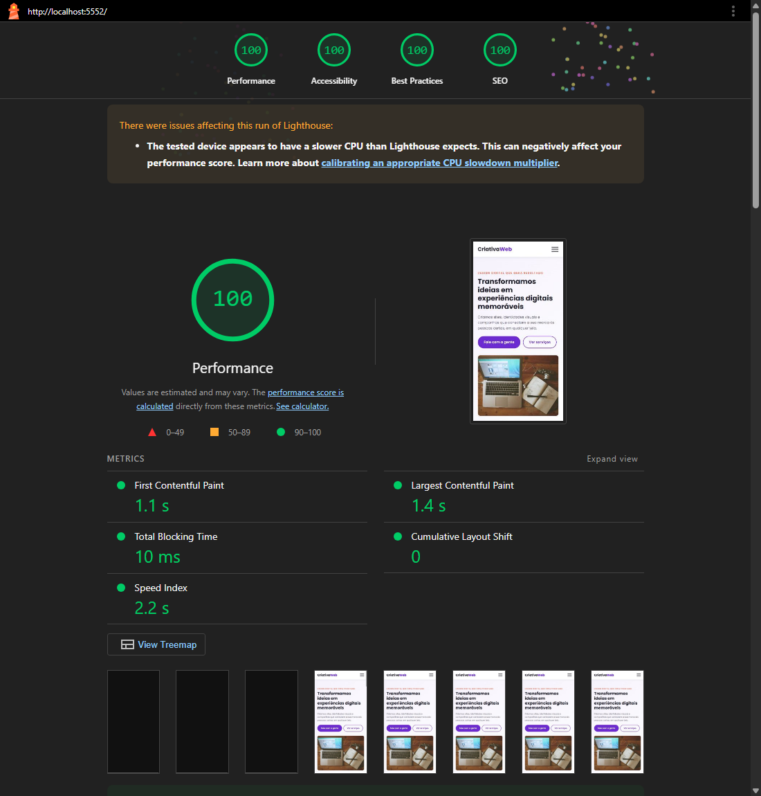

# Performance: Agência Criativa Web (antes × depois)

Análise e otimização de performance do site **Agência Criativa Web**, feito nos Módulos 11 a 13 (HTML, BEM e SASS). Exercício do Módulo 32 do curso de Front-End da EBAC.

## Resultado

Lighthouse 12, modo **celular** (rede e CPU limitadas). Cada versão foi medida **3 vezes**, e a tabela mostra a mediana. As duas versões foram servidas pelo mesmo servidor local, com compressão gzip.

| Métrica | Antes | Depois | Diferença |
|---|---|---|---|
| **Performance** | **89** | **100** | +11 |
| First Contentful Paint (FCP) | 2,3 s | 1,1 s | **−52%** |
| Largest Contentful Paint (LCP) | 3,1 s | 1,4 s | **−55%** |
| Speed Index | 4,1 s | 2,2 s | −46% |
| Total Blocking Time | 0 ms | 10 ms | igual (sem JavaScript) |
| Cumulative Layout Shift | 0 | 0 | igual |
| Peso total da página | 158 KiB | 77 KiB | **−51%** |
| Requisições | 11 | 7 | −4 |
| Boas práticas | 96 | 100 | +4 |
| Rodadas de performance | 89, 89, 90 | 99, 100, 100 | |

Relatórios completos em [`relatorios/`](relatorios/): `antes.html`, `depois.html` (abra no navegador), `antes.png`, `depois.png` (prints) e os resumos `.json`.

| Antes | Depois |
|---|---|
|  |  |

## Gargalos encontrados (relatório "antes")

1. **Recursos que bloqueiam a renderização** (economia estimada de ~1,1 s): a folha de estilo do **Google Fonts** e o `css/estilos.css` precisavam ser baixados antes de qualquer coisa aparecer na tela.
2. **Imagem do LCP lenta**: a foto do banner vinha do `picsum.photos`, que **redireciona** para outro servidor (dois saltos de rede). Ela não tinha prioridade de download.
3. **Formato de imagem antigo**: JPG em vez de AVIF/WebP (economia estimada de 46 KiB).
4. **Fontes em outro domínio**: duas conexões extras (`fonts.googleapis.com` e `fonts.gstatic.com`).
5. **Favicon inexistente**: requisição com erro 404 (reduzia a nota de Boas práticas).

## Melhorias aplicadas

| # | Técnica | Onde |
|---|---|---|
| 1 | **Imagens em AVIF e WebP** (JPG como reserva) com `<picture>`, em 3 larguras (480/960/1440). A foto do banner caiu de 161 KB para 34 KB (960px, AVIF) | `scripts/otimizar-imagens.mjs` (biblioteca **sharp**), pasta `img/` |
| 2 | **Imagens locais**, sem o redirecionamento do picsum | `img/` |
| 3 | **Prioridade para a imagem LCP**: `<link rel="preload" as="image">` + `fetchpriority="high"` | `<head>` e banner do `index.html` |
| 4 | **`loading="lazy"`** e `decoding="async"` na imagem que fica fora da primeira tela | seção Sobre |
| 5 | **Fontes hospedadas no próprio site** (WOFF2, só os caracteres latinos), com `font-display: swap` e `preload` das duas mais usadas | pasta `fonts/` + `@font-face` no `<head>` |
| 6 | **CSS minificado e colocado direto no HTML** (CSS crítico inline): nenhuma folha de estilo bloqueia mais a renderização | `scripts/build.mjs` (SASS `compressed`) |
| 7 | **HTML minificado** (sem espaços nem comentários) | `scripts/build.mjs` (**html-minifier-terser**) |
| 8 | **Remoção de código não usado**: saíram os `preconnect` e o `<link>` do Google Fonts | `index.html` |
| 9 | **Favicon** em SVG (0,3 KB) | `favicon.svg` |

- **JavaScript:** o site não usa nenhum, então não havia JS para minificar nem bibliotecas pesadas para trocar.
- **CSS morto:** a refatoração com BEM (Módulo 12) já tinha removido o CSS não usado, e o Lighthouse não apontou regras sem uso.

### O que trouxe mais impacto

1. **Tirar os recursos bloqueantes** (fontes locais + CSS inline): foi o que mais derrubou o **FCP**, de 2,3 s para 1,1 s.
2. **Imagem do banner em AVIF, local e com prioridade**: foi o que mais derrubou o **LCP**, de 3,1 s para 1,4 s, e metade do peso da página.

## Estrutura

```
index.html                 código-fonte (com comentários "OTIMIZAÇÃO")
scss/                      estilos em SASS (do Módulo 13)
css/estilos.css            CSS compilado para desenvolvimento
fonts/                     Poppins 400/600/700 em WOFF2 (licença SIL Open Font)
img/original/              fotos originais em JPG
img/                       versões geradas: AVIF, WebP e JPG em 480/960/1440
scripts/
├── otimizar-imagens.mjs   gera as imagens otimizadas (sharp)
└── build.mjs              SASS comprimido + CSS inline + HTML minificado -> dist/
dist/                      versão de produção (a que foi medida no "depois")
relatorios/                Lighthouse antes e depois
```

## Como rodar

```bash
npm install
npm run imagens   # gera img/*.avif, *.webp e *.jpg a partir de img/original
npm run build     # gera a pasta dist/ otimizada
npx serve dist    # abre a versão de produção
```

Para repetir a medição: abra a página no Chrome → DevTools → **Lighthouse** → modo *Mobile* → *Analyze page load*. O histórico do Git mostra as duas versões: o primeiro commit é o site original, o segundo é o otimizado.

## Tecnologias

HTML5 · SASS · sharp · html-minifier-terser · Lighthouse 12
